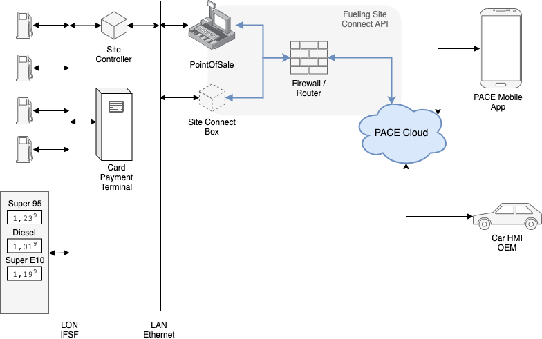
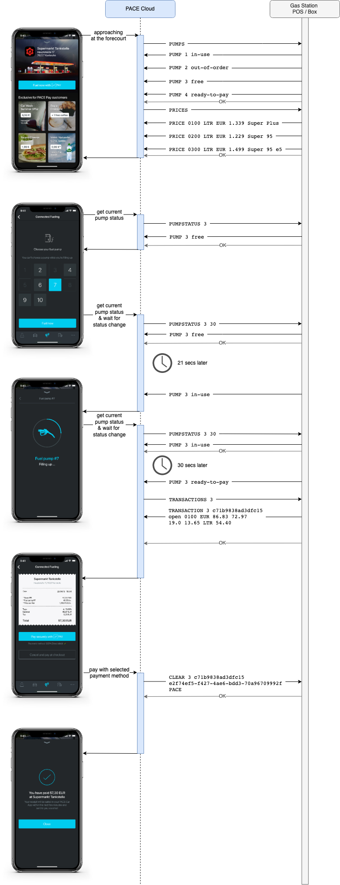
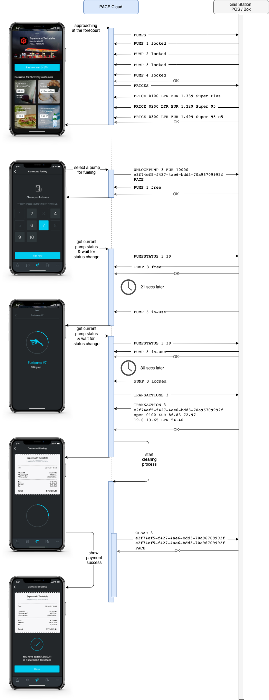
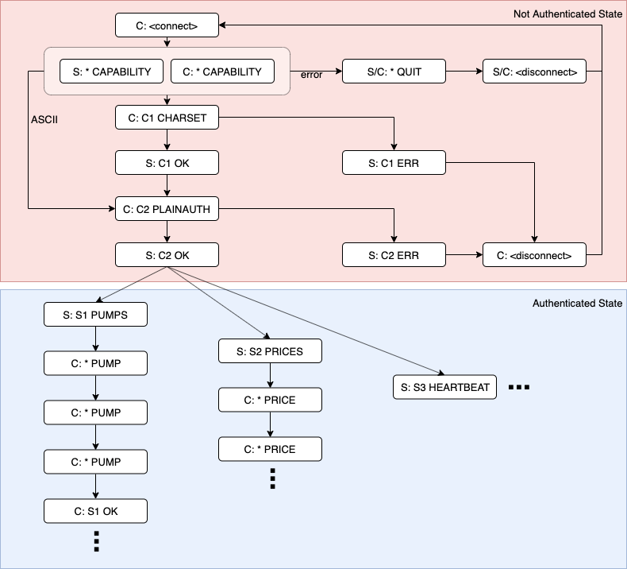

# OpenFSC Protocol Specification (Version 1.0)


Copyright (c) 2019–2026 PACE Mobility GmbH

## Table of contents

- [OpenFSC Protocol Specification (Version 1.0)](#openfsc-protocol-specification-version-10)
  - [Table of contents](#table-of-contents)
  - [1 About This Document](#1-about-this-document)
    - [1.1 Not Part of this Document](#11-not-part-of-this-document)
  - [2 Architecture Overview](#2-architecture-overview)
    - [2.1 Parties](#21-parties)
    - [2.2 Requirements](#22-requirements)
  - [3 Process Overview](#3-process-overview)
    - [3.1 Post-Pay Process](#31-post-pay-process)
    - [3.2 Pre-Auth Process](#32-pre-auth-process)
  - [4 Communication Protocol](#4-communication-protocol)
    - [4.1 Plain Text Protocol](#41-plain-text-protocol)
      - [4.1.1 TAG](#411-tag)
      - [4.1.2 Methods and Arguments](#412-methods-and-arguments)
        - [Handshake/Not Authenticated State](#handshakenot-authenticated-state)
          - [`CAPABILITY`](#capability)
          - [`CHARSET` (Encoding Method)](#charset-encoding-method)
          - [`PLAINAUTH` (Authentication Method)](#plainauth-authentication-method)
        - [Authenticated State](#authenticated-state)
          - [`CLEAR`](#clear)
          - [`HEARTBEAT`](#heartbeat)
          - [`LOCKPUMP`](#lockpump)
          - [`PRICE`](#price)
          - [`PRICES`](#prices)
          - [`PUMP`](#pump)
          - [`PUMPS`](#pumps)
          - [`PUMPSTATUS`](#pumpstatus)
          - [`TRANSACTION`](#transaction)
          - [`TRANSACTIONS`](#transactions)
          - [`UNLOCKPUMP`](#unlockpump)
          - [`LOCKEDPUMP`](#lockedpump)
        - [General (Always Valid/Special Methods)](#general-always-validspecial-methods)
          - [`BEAT`](#beat)
          - [`ERR` (Special)](#err-special)
          - [`OK` (Special)](#ok-special)
          - [`QUIT`](#quit)
      - [4.1.3 Example Plaintext Session](#413-example-plaintext-session)
      - [4.1.4 EBNF](#414-ebnf)
      - [4.1.5 Protocol Extensions](#415-protocol-extensions)
      - [4.1.6 Supported Currencies](#416-supported-currencies)

## 1 About This Document

This document describes the measures required to enable a gas station forecourt system to become part of the Connected Fueling platform. The whole process is also known as "pay-at-the-pump" and enables customers to pay for fuel using a smartphone (or directly from within the car using the integrated HMI system) while staying on the forecourt, without entering the gas station shop.

The process can be summarized as follows:

- The customer stops the car at the forecourt
- Using the app, the customer selects the correct pump and can inspect the fueling-related data
- The customer refuels
- The customer pays using the mobile app (Mobile Payment)

The flow described above refers to a mobile phone; the flow for a car HMI is exactly the same. Therefore, all examples in this document refer to the mobile app.

The Fueling Site Connect API is hereinafter referred to as "OpenFSC".

### 1.1 Not Part of this Document

The payment process itself is not part of this document, because payment is the responsibility of the OpenFSC server side. The server only signals to the gas station that the fueling has been paid.

Onboarding a gas station requires some metadata about the station. This includes, but is not limited to, the address, the geolocation (latitude, longitude), the brand and the station name. This data is needed to route the customer to a gas station, to help them understand the current pump selection, and to allow the app to automatically find the correct gas station for a given location.

The expected data and the ways to integrate it are described in a separate document:

- [PACE POI Service: Gas Station Data](https://docs.pace.cloud/en/services/poi-service/gas-station-data)

The documentation for the API and the interaction between the app and the Connected Fueling API can be found here:

- [PACE Developer Documentation](https://docs.pace.cloud/)
- [Connected Fueling API Documentation](https://developer.pace.cloud)

## 2 Architecture Overview

- The gas station (also referred to as the Site) uses either a POS (Point of Sale) or dedicated hardware (Site Connect Box) that connects to the OpenFSC server in order to enable Mobile Payment.
- To connect the POS or the dedicated hardware to an OpenFSC server, an internet connection in conjunction with simple but secure communication protocols is used.
- On the customer side, multiple clients implement the Connected Fueling API, ranging from HMIs (Human Machine Interfaces) in new cars to retrofit solutions like the PACE Car platform, PACE Drive and many other mobility-focused mobile apps.



### 2.1 Parties

The main parties in the Connected Fueling process are:

- The **customer** with the **mobile app**

  Uses a client of the Connected Fueling platform to get up-to-date information about the gas station and to pay for fuel.

- The **gas station** using either a **POS**, a connected **Site controller**, **Site Connect software** running somewhere within the station's network, or a **Site Connect Box** running that software.

  One of the above components initiates the connection to the OpenFSC server to provide prices, pump statuses and (open) transactions, and to accept transaction clearing.

- **PACE** with its **Connected Fueling** platform

  Accepts connections from many parties (mobile apps, in-car HMI systems, ...), translates (proprietary) protocols and exchanges station, pump, fueling and payment information.

### 2.2 Requirements

The following minimum requirements are assumed when implementing OpenFSC:

- An internet connection
- Ability to connect to an OpenFSC server via either
  - Secure WebSockets over port 443 (TLS 1.2)
  - A plain-text TCP stream protocol over a secured VPN (e.g. IPsec)
- Access to the pump status information of all pumps
- Ability to inform the OpenFSC server about pump status changes
- Access to the current fuel prices, including the product ID, name, ...
- Ability to inform the OpenFSC server about price changes when they occur
- Access to the current, uncleared transactions on the pumps, including
  - the transaction ID
  - the transaction state
  - the product ID
  - the fueled amount
  - the total net and gross prices and the VAT rate
- Information about the currency used and the current time
- Authentication data needed to connect to an OpenFSC server

## 3 Process Overview

The Connected Fueling process can be divided into two main processes: the Post-Pay and the Pre-Auth process. The Post-Pay process is very common in Germany and means that payment takes place after fueling. The Pre-Auth process is widely used outside of Germany and at unmanned 24/7 stations. Both processes can be implemented using the OpenFSC protocol and are described below using the plain text protocol (secured using TLS 1.2 or a VPN) offered by OpenFSC.

Both processes start by updating the current pump and price information in order to present up-to-date data to the user. Price changes need to be sent via OpenFSC as they occur, so that current prices can be shown to users who have not yet reached the forecourt.

### 3.1 Post-Pay Process

- The user selects a pump, which is reflected in the protocol by retrieving the current status of that pump once again. This is necessary because the user can go back to the overview and select another pump if the wrong one was chosen. Therefore, retrieving up-to-date pump information is the first step.
- Requesting the pump status with a TTL (time to live) asks the client to continuously send status updates for the given pump for the given amount of time.
- Once the pump reaches the **ready-to-pay** state, the open transactions are requested via OpenFSC. This information is used to show a nicely formatted bill to the customer.
- The customer selects a payment method they have already registered in their digital wallet and pays. Please note: the registration of payment methods is not covered by this document.



### 3.2 Pre-Auth Process

- The user has to pre-authorize the payment. The amount is either explicitly chosen by the user or implicitly set high enough for a full fueling to take place (tank size × fuel price × 120%).
- The status updates work in the same way as for a Post-Pay fueling; the only difference is that the process waits until the **locked** state is reached. The gas station then captures the pre-authorized amount by reporting the quantity of product dispensed and the total price.
- In case of cancellation (no fuel dispensed), the client does not report a transaction but uses the [`LOCKEDPUMP`](#lockedpump) method to indicate that the process was cancelled.
- The user is presented with the transaction receipt/delivery note and informed that the transaction is complete.



## 4 Communication Protocol

This section specifies the general communication protocol between a Site and the OpenFSC server.

The protocol is independent of the particular transmission subsystem and requires only a reliable and ordered data channel (e.g. WSS or TCP stream).

Usually, each communication channel belongs to exactly one client-server pair. If you would like to connect multiple Sites through a single client-server connection, you can use the [Connection Multiplexing](ext/connection-multiplexing.md) extension in your implementation.

The Site has to initiate the connection to the OpenFSC server. If the connection drops, the Site needs to reconnect immediately.

### 4.1 Plain Text Protocol

The protocol consists of predefined messages. A message always starts with a so-called `tag`, followed by a `method`, the arguments `arg0` to `argN` and an optional special last argument `argV`. The end of a message is indicated by `<CRLF>` (`\r\n`):

```xml
<tag> <method> <arg0> <arg1> ... <argN> <argV>\r\n
```

All message fields except the termination sequence `<CRLF>` are separated by spaces, and the default message encoding is `ASCII`. The encoding can be changed using the special method `CHARSET`, which is described in a later section.

To establish a connection, the client first opens a data channel (e.g. TCP) to the server and starts a handshake to establish the actual Site API connection. This initialization phase is called the "Not Authenticated State" and consists of a special sequence of messages that negotiate the communication contract between the server and the client. The first message sent by each side must always be a `CAPABILITY` notification. If an error occurs on either side, the corresponding party disconnects and may optionally send a `QUIT` notification with further information about the error beforehand. After a successful capability exchange, the client can change the protocol encoding by sending one of the encoding messages specified below. The initialization phase is concluded with an authentication message such as `PLAINAUTH`. If everything was successful, the connection is considered established and transitions into the "Authenticated State".



#### 4.1.1 TAG

The `<tag>` indicates the type of the message as well as the current context and needs to satisfy the format `"*" | letter { letter | digit }` (see EBNF for full specification). There are currently two supported message types:

**Request/Response** - indicated by the tag `letter { letter | digit }`

In this case, the tag specifies the message context: if one party sends a request with the tag `S1`, the receiving party answers with the same tag `S1` in its response. The established context is valid until a timeout is triggered or the recipient answers with an `OK` or `ERR` response. The tag of a request must match the tag of its response.

```text
S: S6 HEARTBEAT 2019-11-13T07:00:04Z
C: S6 BEAT 2019-11-13T08:00:05+01:00
C: S6 OK
```

**Notification** - indicated by the tag `"*"`

A notification is a message that expects no response. Apart from the guarantees of the reliable transport, there is no acknowledgement of any kind that the message was processed correctly.

```text
C: * PUMP 1 free
C: * PUMP 2 free
C: * PUMP 3 in-use
C: * PUMP 4 ready-to-pay
```

Notifications can also be sent as part of the answer to a previously issued request:

```text
S: S1 PUMPS
C: * PUMP 1 free
C: * PUMP 2 free
C: * PUMP 3 in-use
C: * PUMP 4 ready-to-pay
C: S1 OK
```

#### 4.1.2 Methods and Arguments

A message represents an operation that should be performed by the receiving side. Each message consists of a method and a list of defined arguments. Each method has its own arguments and message type (Request/Response or Notification). The method name must follow the format `letter { letter | digit }`, while all regular arguments (`arg0` to `argN`) can use all characters of the specified encoding except control characters and spaces (`"\x21"…"\x7E"`). The method and all arguments are separated by spaces. The last argument can be a so-called "variadic" argument (`argV`), which can contain any sequence of characters compatible with the negotiated protocol encoding except `<CRLF>` (`"\x00"…"\xff" - "\r" - "\n"`). The last argument (`argN` or `argV`), and thus the whole message, is terminated by `<CRLF>` (`\r\n`).

##### Handshake/Not Authenticated State

###### `CAPABILITY`

Type: **Notification**

Direction: **Server → Client, Client → Server**

This is always the first message sent by each party. It contains the methods supported by the sending party. If an error occurs while receiving or processing the capabilities of the other party, the recipient should terminate the connection. Optionally, it can send a `QUIT` message to provide additional information before disconnecting.

Arguments:

- **Space-separated list of methods supported by the sending party**

Please note that the list of capabilities is of variable (not fixed) length.

###### `CHARSET` (Encoding Method)

Type: **Request/Response**

Direction: **Client → Server**

Change the protocol encoding for all subsequent messages. If the encoding change was successful, OK will be returned. In case of an error, the server returns an ERR message. **CAUTION:** The response to this request still uses the previous encoding (default: `ASCII`).

Arguments:

- **Name** (arg0, string): supported values: `WINDOWS-1252`, `ISO-8859-1`, `UTF-8` (more charsets available on request)

Errors:

- **404** Unknown encoding

###### `PLAINAUTH` (Authentication Method)

Type: **Request/Response**

Direction: **Client → Server**

Authenticate the client using plain credentials. If the authentication was successful, OK will be returned. In case of an error, the server responds with an ERR message.

Arguments:

- **SiteAccessKey** (arg0, uuid): identification of the connecting site
- **Secret** (arg1, string): corresponding secret for proof of identification

Errors:

- **401** SiteAccessKey and/or secret are not valid

##### Authenticated State

###### `CLEAR`

Type: **Request/Response**

Direction: **Server → Client**

Mark a transaction as cleared (paid) by the server. This frees the occupied pump and deletes the corresponding transaction. If the operation was successful, OK will be returned. In case of an error, the client returns an ERR message.

If the client cannot acknowledge the `CLEAR` due to a network disconnect, the server does not know whether the `CLEAR` was processed. The transaction can then be in one of two states: `open` or `cleared`. If the transaction is still `open`, it will be reported by the regular `TRANSACTIONS` call, and the server can safely assume that the `CLEAR` was never received and retry it. If the transaction was `cleared`, it is no longer reported by the `TRANSACTIONS` call. The server cannot tell whether this was caused by its `CLEAR` or by a payment in the shop. To resolve this, the server retries the `CLEAR` after the client has reconnected.

If the client responds with **403**, the payment was made externally (usually in the shop) and the transaction was **not** cleared by the server. If the client responds with **410**, the initial `CLEAR` was processed by the client and the server can assume that the payment was successful. Some clients only store transactions for a limited period of time (e.g. 24h). If the connection is not re-established within that period, the client may respond with **404** because the transaction is no longer known. This triggers an expensive back-office process and should be avoided if possible. Summary of the error codes on retry and how they are interpreted:

- **404** The initial clearing was too long ago and the client no longer knows the transaction → back-office process
- **403** The payment was made by other means → the payment transaction will be cancelled
- **410** The transaction was accepted → transaction successful

**Important:** Please make sure that transactions cleared via OpenFSC are marked as such in the **reconciliation lists** shared with the MOC (mineral oil company), e.g. by adding a field "Clearance source" with the value "Connected Fueling" and the used **PaymentMethod** to the lists.

Arguments:

- **Pump** (arg0, number): identifier of the concerned pump. Lowest possible value: 1.
- **SiteTransactionID** (arg1, string): ID of the transaction that should be cleared, as defined by the client in a previous `TRANSACTION` message. If the transaction was started with `UNLOCKPUMP`, the **SiteTransactionID** and **FSCTransactionID** may be the same, since the site reports the transaction ID provided by OpenFSC.
- **FSCTransactionID** (arg2, uuid): ID defined by the server. If the transaction was started with `UNLOCKPUMP`, the ID must match the one sent with that `UNLOCKPUMP` request.
- **PaymentMethod** (arg3, string): identifier of the payment method used, e.g. `pace`, `dkv`, ...

The following options are currently supported as **PaymentMethod**:

- `pace`
- `dkv`
- `esso`
- `hoyer`
- `logpay`
- `omv`
- `pfc`
- `roadrunner`
- `tfc`

Errors:

- **404** Pump and SiteTransactionID unknown
- **403** Payment method not permitted
- **410** SiteTransactionID is no longer open and was already cleared with the same FSCTransactionID

###### `HEARTBEAT`

Type: **Request/Response**

Direction: **Server → Client**

Check whether the client is still available and determine the time drift between server and client. This method is issued regularly to detect time drift and to check that the communication channel between server and client is up and running.

The client answers with a tagged `BEAT` message before sending `OK`. If an error occurred, the client returns an `ERR` message.

The client must answer the `HEARTBEAT` message within 20 seconds, otherwise the communication channel is considered unstable. Repeated failures to answer in time will result in the communication channel being forcefully closed (`QUIT`).

Arguments:

- **Timestamp** (arg0, string): time at which this message was sent in the format of `RFC-3339`.

Errors:

- **422** Timestamp invalid

###### `LOCKPUMP`

Type: **Request/Response**

Direction: **Server → Client**

Cancel, from the server side, a fueling process previously started with `UNLOCKPUMP`. If the operation was successful, OK will be returned. In case of an error, the client returns an ERR message.

Arguments:

- **Pump** (arg0, number): identifier of the concerned pump. Lowest possible value: 1.

Errors:

- **402** Payment required (pump can't be locked due to a pending payment)
- **404** Pump unknown
- **423** Already locked

###### `PRICE`

Type: **Notification**

Direction: **Client → Server**

Price per litre of a specific product. Should be sent in response to a previous `PRICES` request and may be sent proactively whenever a price changes.

Arguments:

- **ProductID** (arg0, string): identifier of the product. (e.g.: 0100)
- **Unit** (arg1, string): unit used by the subsequent **PricePerUnit** argument. Supported values: **LTR**
- **Currency** (arg2, string): currency used by the subsequent **PricePerUnit** argument. Supported values, see [Supported Currencies](#416-supported-currencies), for example **EUR**.
- **PricePerUnit** (arg3, decimal): end user price per unit including VAT in the specified **Unit** (arg1) and the specified **Currency** (arg2). (e.g. for EUR/LTR: 1.339)
- **Description** (argV): human-readable name/description of the product. (e.g.: Super Plus)

Please consider implementing the [Product Mapping extension](ext/product-mapping.md) in your client to announce products with their respective type before transferring price information.

###### `PRICES`

Type: **Request/Response**

Direction: **Server → Client**

Get the current prices per litre of all available products. The client must make sure that all prices have been transmitted with `PRICE` notifications before sending `OK` to conclude the `PRICES` request. In case of an error, the client returns an ERR message.

Arguments: **None**

###### `PUMP`

Type: **Notification**

Direction: **Client → Server**

Status of a specific pump. Should be sent in response to a `PUMPS`, `PUMPSTATUS` or `UNLOCKPUMP` request and may be sent proactively whenever the status of a pump changes.

Arguments:

- **Pump** (arg0, number): identifier of the pump. Lowest possible value: 1.
- **Status** (arg1, string): current status of the pump. Supported values: **free**, **in-use**, **ready-to-pay**, **locked** or **out-of-order**. The value **in-transaction** is deprecated and will be removed in future versions; clients should not send it.

###### `PUMPS`

Type: **Request/Response**

Direction: **Server → Client**

Get the status of all pumps at the site. The client must make sure that the status of every pump has been transmitted with `PUMP` notifications before sending `OK` to conclude the `PUMPS` request. In case of an error, the client returns an ERR message.

Arguments: **None**

###### `PUMPSTATUS`

Type: **Request/Response**

Direction: **Server → Client**

Get the status of a specific pump. The client must make sure that the status of the requested pump has been transmitted with a `PUMP` notification before sending `OK` to conclude the `PUMPSTATUS` request. In case of an error, the client returns an ERR message.

Arguments:

- **Pump** (arg0, number): identifier of the concerned pump. Lowest possible value: 1.
- **UpdateTTL** (arg1, number, optional): time to live in seconds during which the server expects updates from the client. After the `OK` response, the client informs the server about status changes of the specified pump until the TTL expires. Only actual status changes should be sent in this case.

Errors:

- **404** Pump unknown
- **416** UpdateTTL is too high or too low (valid range: 30–300)

###### `TRANSACTION`

Type: **Notification**

Direction: **Client → Server**

Information about a specific open or deferred transaction of a pump. Should be sent in response to a previous `TRANSACTIONS` request and may be sent proactively whenever the status of a transaction changes.

Note: `TRANSACTION` shall only be used if product was actually dispensed (non-zero amount/quantity). If the fueling is cancelled on the station side without any product being dispensed, please use [`LOCKEDPUMP`](#lockedpump) instead (only applicable to the Pre-Auth process).

Arguments:

- **Pump** (arg0, number): identifier of the concerned pump. Lowest possible value: 1.
- **SiteTransactionID** (arg1, string): ID of this transaction. In the Post-Pay process, it is defined by the client (site). In the Pre-Auth process, the SiteTransactionID is the **FSCTransactionID** (provided with `UNLOCKPUMP`).
- **Status** (arg2, string): current status of the transaction. Must be either **open** or **deferred**. A transaction is **open** if the payment has not yet been settled and the pump is **ready-to-pay** or **locked**. A transaction is **deferred** if it was previously **open** but the pump was released again by the site operator (set to **free**). This can happen if a customer was not able to pay for their fueling and the site operator needs to take further action. To avoid blocking the pump for other customers, the site operator releases it, and the previously **open** transaction of that pump is marked as **deferred**.
- **ProductID** (arg3, string): identifier of the dispensed product.
- **Currency** (arg4, string): currency used by the subsequent **PriceWithVAT**, **PriceWithoutVAT** and **VATAmount** arguments. Supported values, see [Supported Currencies](#416-supported-currencies), for example **EUR**.
- **PriceWithVAT** (arg5, decimal): price including VAT, associated with the current transaction in the specified **Currency** (arg4). (e.g. for EUR: 86.83)
- **PriceWithoutVAT** (arg6, decimal): price excluding VAT, associated with the current transaction in the specified **Currency** (arg4). (e.g. for EUR: 72.97)
- **VATRate** (arg7, decimal): rate of VAT used in the previous **PriceWithVAT** argument in percent. (e.g.: 19.0)
- **VATAmount** (arg8, decimal): amount of VAT used in the previous **PriceWithVAT** argument in the specified **Currency** (arg4). (e.g. for EUR: 13.86)
- **Unit** (arg9, string): unit used by the subsequent **Volume** argument. Supported values: **LTR**
- **Volume** (arg10, decimal): amount of product dispensed in the specified **Unit** (arg9). (e.g. for LTR: 64.85)
- **PricePerUnit** (arg11, decimal): end user price per unit including VAT in the specified **Unit** (arg9) and the specified **Currency** (arg4). (e.g. for EUR/LTR: 1.339)

###### `TRANSACTIONS`

Type: **Request/Response**

Direction: **Server → Client**

Get all open or deferred transactions of the site, or of a specific pump if one is given. The client must make sure that all transactions have been transmitted with `TRANSACTION` notifications before sending `OK` to conclude the `TRANSACTIONS` request. In case of an error, the client returns an ERR message. The server may request the transactions after a client whose session is in the `active` session mode (see [High Availability](ext/ha.md)) has connected successfully, in order to clear open transactions.

Arguments:

- **Pump** (arg0, number, optional): identifier of the requested pump. Lowest possible value: 1.
- **UpdateTTL** (arg1, number, optional): time to live in seconds during which the server expects updates from the client. After the `OK` response, the client informs the server about transaction changes of the specified pump until the TTL expires. Only actual changes should be sent in this case. Only allowed if **Pump** (arg0) is also specified.

Errors:

- **404** Pump unknown
- **416** UpdateTTL is too high or too low (valid range: 30–300)

###### `UNLOCKPUMP`

Type: **Request/Response**

Direction: **Server → Client**

Unlock a locked pump with pre-authorized credit for a subsequent fueling process. If the operation was successful, OK will be returned. In case of an error, the client returns an ERR message. Optionally, a list of products can be provided to unlock only the nozzles of the specified products. These optional **ProductID** arguments are inspired by the **IFSF FDC_AuthoriseFuelPoint_Request** specification (`maxOccurs="8"`). If no **ProductID**s are provided, all products should be unlocked.

Arguments:

- **Pump** (arg0, number): identifier of the concerned pump. Lowest possible value: 1.
- **Currency** (arg1, string): currency used by the subsequent **Credit** argument. Supported values, see [Supported Currencies](#416-supported-currencies), for example **EUR**.
- **Credit** (arg2, decimal): credit available for the upcoming fueling process in the specified **Currency** (arg1). (e.g. for EUR: 100.00)
- **FSCTransactionID** (arg3, uuid): ID defined by the server. It is returned with the corresponding `TRANSACTION` notification to correlate the transactions.
- **PaymentMethod** (arg4, string): name of the payment method used, e.g. `pace`, `dkv`, ...
- **ProductID1** (arg5, string, optional): identifier of an unlocked product. (e.g.: 0100)
- **ProductID2** (arg6, string, optional): identifier of an unlocked product. (e.g.: 0200)
- **ProductID3** (arg7, string, optional): identifier of an unlocked product. (e.g.: 0300)
- **ProductID4** (arg8, string, optional): identifier of an unlocked product. (e.g.: 0400)
- **ProductID5** (arg9, string, optional): identifier of an unlocked product. (e.g.: 0500)
- **ProductID6** (arg10, string, optional): identifier of an unlocked product. (e.g.: 0600)
- **ProductID7** (arg11, string, optional): identifier of an unlocked product. (e.g.: 0700)
- **ProductID8** (arg12, string, optional): identifier of an unlocked product. (e.g.: 0800)

The following options are currently supported as **PaymentMethod**:

- `pace`
- `dkv`
- `esso`
- `hoyer`
- `logpay`
- `omv`
- `pfc`
- `roadrunner`
- `tfc`

Errors:

- **403** Payment method not permitted
- **404** Pump or ProductID unknown
- **412** Pump is in use: it was already unlocked or is currently used by someone else (e.g. a customer paying at the POS or with another payment method). The pump was not unlocked.
- **422** Currency unknown

###### `LOCKEDPUMP`

Type: **Request/Response**

Direction: **Client → Server**

Informs the server that the transaction could not be completed due to an issue at the pump. This cancels, from the client side, a fueling process previously started with `UNLOCKPUMP`. If the operation was successful, OK will be returned. In case of an error, the server returns an ERR message.

Arguments:

- **Pump** (arg0, number): identifier of the concerned pump. Lowest possible value: 1.
- **FSCTransactionID** (arg1, uuid): ID defined by the server, as provided with `UNLOCKPUMP`.
- **Reason** (arg2, string): reason why the pump was locked
  - `aborted`: zero fueling/transaction
  - `timeout`: the system aborted the fueling due to a timeout

Errors:

- **404** Invalid transaction and/or pump combination
- **403** Transaction is in an invalid state and can't be cancelled
- **400** Invalid reason

##### General (Always Valid/Special Methods)

###### `BEAT`

Direction: **Client → Server**

Informational response to a `HEARTBEAT` request. This method is purely informational for the server and *does not conclude* the `HEARTBEAT` request. In order to complete the request, the client must also send an `OK` message. Please refer to [`HEARTBEAT`](#heartbeat) for more information.

Arguments: **Timestamp** (arg0, string): time at which this message was sent in the format of `RFC-3339`.

###### `ERR` (Special)

Direction: **Server → Client, Client → Server**

Concludes a Request/Response exchange unsuccessfully and terminates the corresponding tag.

Arguments:

- **Code** (arg0, number): one of the following error codes, or a method-specific error code
  - **400** Bad request (invalid method, arguments or tag)
  - **403** Method issued in the wrong connection state (e.g. a method of the "Authenticated State" issued in the "Not Authenticated State", or vice versa)
  - **405** Method unknown
  - **406** Wrong encoding (bytes don't comply with the current encoding)
  - **500** Internal server error
- **Message** (argV): human-readable error message

###### `OK` (Special)

Direction: **Server → Client, Client → Server**

Concludes a Request/Response message successfully and terminates the corresponding tag.

Arguments: **None**

###### `QUIT`

Type: **Notification**

Direction: **Server → Client, Client → Server**

Signals the upcoming disconnect of the sending party. This method is used to send information before terminating the connection. However, the client is not required to send `QUIT` before disconnecting; it can also simply close the connection. After receiving `QUIT`, the server drops the corresponding connection. If the [Connection Multiplexing](ext/connection-multiplexing.md) extension is used, the client can use the `QUIT` notification to close a session. If the initial session of a multiplexed connection (no `sessionID`) is closed with `QUIT`, all sessions depending on it are dropped without further notice.

Arguments:

- **Message** (argV): reason for terminating the connection.

#### 4.1.3 Example Plaintext Session

The following example session shows the mobile payment process for Post-Pay.

```text
C: * CAPABILITY CLEAR HEARTBEAT LOCKPUMP PRICES PUMPS PUMPSTATUS QUIT TRANSACTIONS UNLOCKPUMP
S: * CAPABILITY BEAT CHARSET PLAINAUTH PRICE PUMP TRANSACTION LOCKEDPUMP QUIT
C: C0 CHARSET ISO-8859-1
S: C0 OK
C: C1 PLAINAUTH 9eb56d5e-6563-430a-9d39-5ddf567e73d5 1d3b755d3bce8f09b4f8ff08dabf1796
S: C1 OK
S: S0 PRICES
C: * PRICE 0100 LTR EUR 1.339 Super Plus
C: * PRICE 0200 LTR EUR 1.229 Super 95
C: * PRICE 0300 LTR EUR 1.499 Super 95 e5
C: S0 OK
S: S1 PUMPS
C: * PUMP 1 in-use
C: * PUMP 2 out-of-order
C: * PUMP 3 free
C: * PUMP 4 ready-to-pay
C: S1 OK
S: S2 PUMPSTATUS 3
C: * PUMP 3 free
C: S2 OK
S: S3 PUMPSTATUS 3 30
C: * PUMP 3 free
C: S3 OK
C: * PUMP 3 in-use
C: * PUMP 3 ready-to-pay
S: S4 TRANSACTIONS
C: * TRANSACTION 3 c71b9838ad3dfc15 open 0100 EUR 86.83 72.97 19.0 13.86 LTR 64.85 1.339
C: S4 OK
S: S5 CLEAR 3 c71b9838ad3dfc15 e2f74ef5-f427-4ae6-bdd3-70a96709992f pace
C: S5 OK
S: S6 HEARTBEAT 2019-11-13T07:00:04Z
C: S6 BEAT 2019-11-13T08:00:05+01:00
C: S6 OK
C: * QUIT bye bye
```

#### 4.1.4 EBNF

```text
letter = "a"…"z" | "A"…"Z" .
digit = "0"…"9" .
digits = digit { digit } .
hex = "a"…"f" | digit .
char = "\x21"…"\x7E" .
any = "\x00"…"\xFF" - "\r" - "\n" .
space = "\x20" .
hexq = hex hex hex hex .
uuid = hexq hexq "-" hexq "-" hexq "-" hexq "-" hexq hexq hexq .

number = "0" | ( ( "1"…"9" ) digits ) .
decimal = number "." digits .
string = char { char } .

ident = letter { letter | digit } .

tag = "*" | ident .
argv = any { any } .
currency = "EUR" | "CHF" | "GBP" |
    "DKK" | "SEK" | "NOK" |
    "PLN" | "CZK" | "HUF" |
    "RON" .
unit = "LTR" .

pump_status = "free" |
    "in-use" |
    "ready-to-pay" |
    "locked" |
    "out-of-order" .

transaction_status = "open" |
    "deferred" .

method = "BEAT" |
    "CHARSET" |
    "CLEAR" |
    "HEARTBEAT" |
    "LOCKPUMP" |
    "LOCKEDPUMP" |
    "PLAINAUTH" |
    "PRICE" |
    "PRICES" |
    "PUMP" |
    "PUMPS" |
    "PUMPSTATUS" |
    "TRANSACTION" |
    "TRANSACTIONS" |
    "QUIT" |
    "UNLOCKPUMP" |
    extension_method .

extension_method = "NEWSESSION" |
    "PAN" |
    "PRODUCT" |
    "PRODUCTS" |
    "PUSH" |
    "PUSHING" |
    "RECEIPTINFO" |
    "SESSION" |
    "SESSIONMODE" |
    "SESSIONS" |
    "TRANSACTIONINFO" .

encoding = "WINDOWS-1252" |
    "ISO-8859-1" |
    "UTF-8" .

capability_method = "CAPABILITY"
    { space method } .

charset_method = "CHARSET"
    space encoding .

plainauth_method = "PLAINAUTH"
    space uuid
    space string .

clear_method = "CLEAR"
    space number
    space string
    space uuid
    space string .

heartbeat_method = "HEARTBEAT"
    space string .

lockpump_method = "LOCKPUMP"
    space number .

price_method = "PRICE"
    space string
    space unit
    space currency
    space decimal
    space argv .

prices_method = "PRICES" .

pump_method = "PUMP"
    space number
    space pump_status .

pumps_method = "PUMPS" .

pumpstatus_method = "PUMPSTATUS"
    space number
    [ space number ] .

transaction_method = "TRANSACTION"
    space number
    space string
    space transaction_status
    space string
    space currency
    space decimal
    space decimal
    space decimal
    space decimal
    space unit
    space decimal
    space decimal .

transactions_method = "TRANSACTIONS"
    [ space number [ space number ] ] .

unlockpump_method = "UNLOCKPUMP"
    space number
    space currency
    space decimal
    space uuid
    space string
    [ space string ]
    [ space string ]
    [ space string ]
    [ space string ]
    [ space string ]
    [ space string ]
    [ space string ]
    [ space string ] .

lockedpump_method = "LOCKEDPUMP"
    space number
    space uuid
    space string .

beat_method = "BEAT"
    space string .

err_method = "ERR"
    space number
    space argv .

ok_method = "OK" .

quit_method = "QUIT"
    space argv .

any_method = beat_method |
    capability_method |
    charset_method |
    clear_method |
    err_method |
    heartbeat_method |
    lockpump_method |
    lockedpump_method |
    ok_method |
    plainauth_method |
    price_method |
    prices_method |
    pump_method |
    pumps_method |
    pumpstatus_method |
    quit_method |
    transaction_method |
    transactions_method |
    unlockpump_method .

message = tag space ( any_method ) "\r\n" .
```

#### 4.1.5 Protocol Extensions

This section lists the available protocol extensions. All extensions are optional, and the communicating parties agree on the extensions to use via the `CAPABILITY` message. In other words, an extension is only used if both sides announce it in their `CAPABILITY` message. The server and the client each announce the methods they handle.

- [Connection Multiplexing](ext/connection-multiplexing.md)
- [Product Mapping](ext/product-mapping.md)
- [High Availability](ext/ha.md)
- [Transaction Information](ext/transaction-info.md) (replacement of the [PAN](ext/pan.md) extension)
- [Receipt Information](ext/receipt-information.md)
- [Pushing Data](ext/pushing.md)

#### 4.1.6 Supported Currencies

Currencies are specified using their ISO 4217 alphabetic code (see <https://en.wikipedia.org/wiki/ISO_4217>). The following currencies are currently supported:

| Code  | Currency         |
| ----- | ---------------- |
| `EUR` | Euro             |
| `CHF` | Swiss franc      |
| `GBP` | Pound sterling   |
| `DKK` | Danish krone     |
| `SEK` | Swedish krona    |
| `NOK` | Norwegian krone  |
| `PLN` | Polish złoty     |
| `CZK` | Czech koruna     |
| `HUF` | Hungarian forint |
| `RON` | Romanian leu     |

Further ISO 4217 currencies are available on request.
